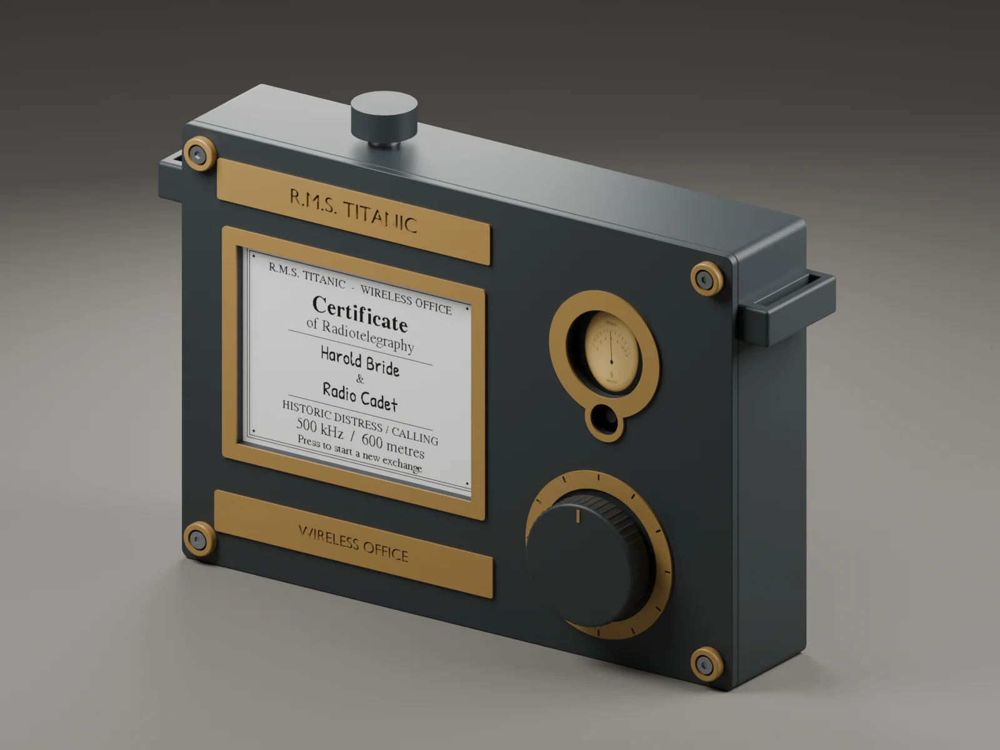

# Titanic wireless

A small wireless office for a Halloween costume: press the key, hear an SOS,
tune for Carpathia, and watch the reply arrive on electronic paper.

Built by Thomas Sarlandie with his son in autumn 2026, using an M5Stack CoreS3,
a Waveshare ePaper module, two EC11 controls, and a printed black-and-gold case.
This is an interactive prop: it does **not transmit or receive RF**.



*Design visualization, not a photograph of the finished build.*

[Project story and interactive demo](https://thomas.sarlandie.net/titanic-radio)
· [Download printable parts](https://github.com/sarfata/titanic-wireless/releases/latest)
· [Wiring](docs/WIRING.md) · [Printing and assembly](docs/PRINTING.md)

## Try it before building

```sh
python3 -m http.server 8765 --bind 127.0.0.1 --directory firmware/preview
```

Open <http://127.0.0.1:8765>. Enable **Morse sound**, then choose **Demo at 500**
for an automatic exchange. Or press **Top button**, let the SOS play, and tune
to 500 kHz for the reply. A second press stops the exchange. After the completed
reply, the certificate appears and the tuning moves away for the next round.

The JavaScript demo uses Morse events exported from the firmware and the same
frequency/volume artwork. It is a behavioral simulation, not an ESP32 emulator.
Physical camera capture, ePaper refresh delays, boot animation, USB charging
mode and deep sleep are not simulated. No account, server or camera permission
is needed; sound is opt-in.

## What is included

| Directory | Contents |
| --- | --- |
| `firmware/src`, `firmware/include` | Arduino C++ firmware, v0.12.1 behavior |
| `firmware/preview` | Self-contained browser demo and JavaScript state machine |
| `firmware/test` | Eleven native C++ test suites and JavaScript regression checks |
| `firmware/blender` | Python generators for the current printable parts |
| `firmware/outputs` | Current STL, 3MF, editable Blender files, and artwork |
| `docs` | Parts list, wiring, printing, validation and reproduction notes |
| `tools/package_release.py` | Makes the print download ZIP and SHA-256 manifest |

The public version uses **Radio Cadet** on the certificate. Personalize
`CERTIFICATE_NAME_2` in `firmware/include/PaperArtwork.h` before building.
The original device has its own personalized certificate; no private camera
captures or bench logs are included here.

## Parts

- **M5Stack CoreS3 K128** with its DIN base and built-in battery, LCD, speaker and camera.
- **Waveshare 4.2-inch monochrome 400 × 300 ePaper module**, including the driver PCB.
  The working build uses the GDEY042T81 driver. Check your panel: a V2 sticker alone
  does not identify every compatible display revision.
- **Two bare EC11 encoders** with push switches and 6 mm ribbed shafts. Only the
  front encoder's rotation and the top encoder's switch are used.
- M5-compatible four-pin pigtails, hookup wire, insulation and strain relief.
- Four **M3 × 8 mm** lid screws and M3 heat-set inserts fitting **4.4 × 6 mm** pilots.
  Insert outside diameters vary. H3–H5 can fit these lid pockets; trial on a coupon.
- Black and gold/brass-coloured PLA. A 222 × 140 mm footprint is needed for the bottom.
- Optional neck/shoulder strap, printable key mechanism and jacket badges.

## Build and upload

Install [PlatformIO Core](https://docs.platformio.org/en/latest/core/installation/index.html).
The ESP32 platform and libraries are pinned in `firmware/platformio.ini`.

```sh
cd firmware
pio run -e cores3
pio run -e cores3 -t upload
pio device monitor -b 115200
```

Wake the device before uploading and use a USB **data** cable. `cores3_legacy_epaper`
is an opt-in build for GDEW042T2 panels, not automatic display detection.
Normal uploads preserve volume and saved photos with the same partition layout.
**Do not erase the chip, upload a filesystem image or change partitions** if you
want to keep them. This repository does not flash anything automatically.

## Controls on the radio

| Action | Result |
| --- | --- |
| Top button | Start or stop the SOS / tuning / reply sequence |
| Turn front encoder | Tune 450–550 kHz; amber digits return to the S-meter after 3 seconds |
| Hold top button for 0.9 s | Volume mode; turn front encoder to adjust, then hear a preview dot |
| Three quick top clicks | Countdown, take a photo, save it in internal flash, show it on ePaper |
| Leave volume or photo idle | Return to normal view after 10 seconds |
| Leave normal operation idle | After 60 seconds: certificate and deep sleep on battery; alembic on USB |
| Press/turn while asleep | Reboot to idle; use a separate next action to start or tune |

Boot/wake plays a silent ghost animation while the ePaper refreshes. It never
starts the story automatically. On USB, the first action leaves the shore-power
view; the next starts normal interaction. The alembic indicates USB supply,
**not battery percentage or confirmed charging completion**.

## Build status and limits

The development firmware was flashed and checked on a real CoreS3. Both controls,
audio, ePaper, and photo capture worked during the build. Software/serial checks
also covered startup, cancellation, standby and timed sleep recovery.

The included bottom is **v1.1**, front **v1.1**, tuning knob **v0.2**, top-button/key
kit **v0.1**. The first enclosure was physically tested; later clearance revisions
passed mesh/slicer checks but have not all been physically revalidated. Review
[the print guide](docs/PRINTING.md), particularly display retention and cable bends.
Whole-device battery life and all-day runtime remain unmeasured.

[Reproduce the assets and run tests](docs/REPRODUCING.md) · [Validation record](docs/VALIDATION.md)

## Licensing and credits

Original firmware, browser demo, CAD generators and printable geometry are
available under the [MIT license](LICENSE). Patrick Hand is under the SIL Open
Font License; its license and font travel with the project. External libraries
retain their own licenses. See [sources and credits](docs/SOURCES.md).

The exchange is a short fictionalized interaction for a costume, not a transcript
of the disaster. The 500 kHz display refers to the historic 600-metre wavelength.
